# Roll for Initiative

An initiative tracker for [Obsidian](https://obsidian.md) that keeps the whole fight as **plain text in your note**. You can run it in the note or from the sidebar.

- It reads HP, AC and initiative from your monster statblocks.
- It writes damage, healing, conditions and death saves straight back to your players' character sheets.
- It supports two game systems: **D&D 5e (2024)** and **Cyberpunk RED**.

> Roll for Initiative is built on [**Quick Initiative**](https://github.com/walkertbrown/quick-initiative) by **walkertbrown** (Bananafest Destiny). It follows Quick Initiative's plain-text block format and its look. See [Credits](#credits).

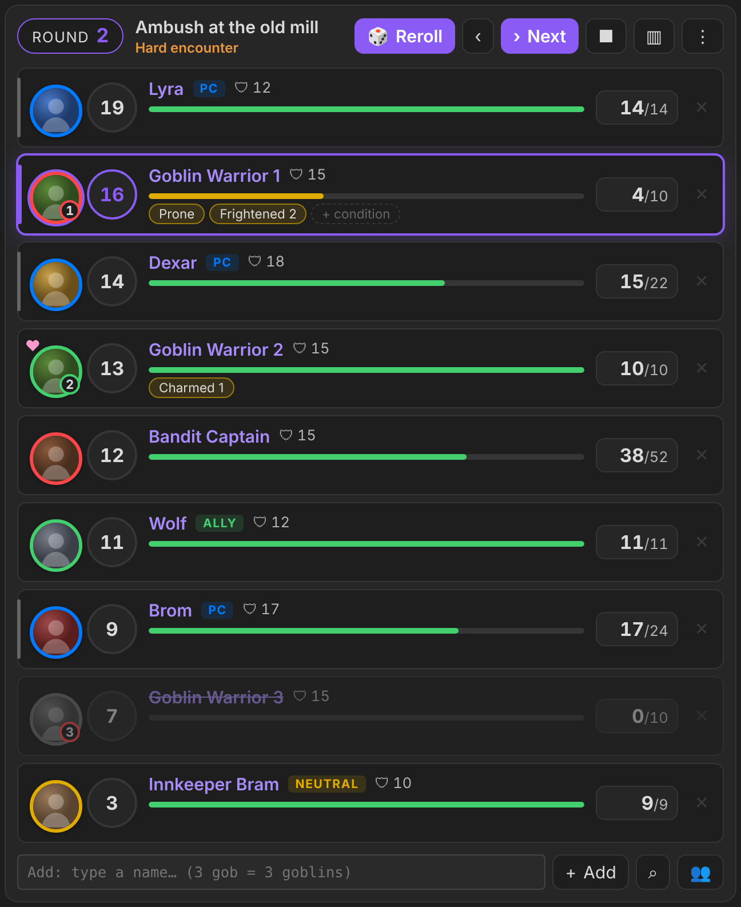

---

## Features

- **The fight is plain text** in a ` ```roll-initiative ``` ` code block. It is readable, it syncs with your vault and it works on mobile. Edit it by hand or with the buttons.
- **Sidebar view**: run the same encounter from the right sidebar. Both views edit the same block.
- **Monster stats from statblocks**:
  - AC, HP, hit dice, initiative modifier, CR and portrait come from the note's ` ```statblock ``` ` (Fantasy Statblocks).
  - If a note has none, the plugin uses its frontmatter instead, then the Fantasy Statblocks bestiary.
  - **Statblock numbers always win.**
- **Live character sheets** (One DnD Character Sheet):
  - HP, temp HP, AC, conditions, exhaustion and death saves are read from the sheet and written back to it.
  - The sheet's own rules apply: temp HP absorbs damage first, 0 HP means dying, three successful saves bring the PC back to 1 HP.
- **Tokens with number badges**: *Goblin 2* keeps its "2" after sorting.
- **Armies and minions**: run 40 goblins as **one row with a shared HP pool**, hit the whole group or several members at once, and watch the "27/40 standing" count drop.
- **Rim colours show the side**: blue = player, red = enemy, yellow = neutral NPC, green = ally. *Charmed* flips the colour. A player character can **turn against the party** (tick **Enemy** in their token menu): red rim, an ENEMY tag, and they count as an enemy.
- **Encounter cards**: write an encounter in a ` ```roll-encounter ``` ` block (Initiative Tracker syntax) and press **Roll Initiative**.
  - The card has players on the left and creatures on the right, with − / + steppers.
  - A badge shows the difficulty (*Easy / Medium / Hard / Deadly encounter*).
  - An optional **Roll for HP** checkbox rolls each creature's HP.
- **One combat note**: every fight goes into one *Roll Initiative* note. If a fight is still running, the plugin asks before overwriting it.
- **Auto-end**: combat ends by itself when every enemy is down.
- **Statblock pane**: click a monster's name to open its statblock in the sidebar.
- **Add box with suggestions**: type `3 gob` and press Enter to add 3 Goblins.
- **Atlas VTT**: start fights from Atlas encounters and keep initiative, HP and conditions in sync with an open Atlas map.
- **Game systems**: switch between D&D 5e (2024) and Cyberpunk RED in Settings.

| Encounter card | Damage / heal box |
|---|---|
| 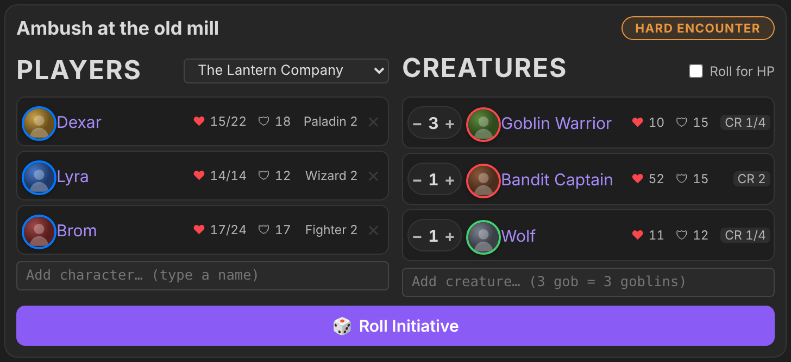 | 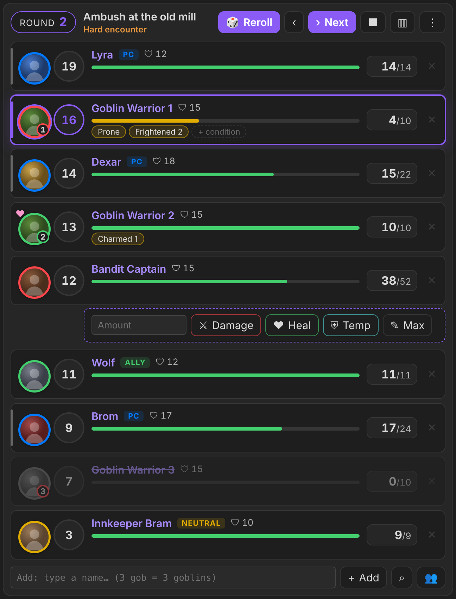 |

### Armies and minions (groups)

Large battles stay manageable: a **group** is one row for many identical creatures. They share one initiative and one **HP pool** (HP each × how many).

- **Make a group** in any of these ways:
  - on an encounter card, click the 👥 button next to a creature with a count above 1 and pick **One group**, **Groups of 10** or a custom size: 50 goblins in groups of 10 = 5 group rows;
  - in the add box, type `40 gob group`;
  - in the block, write `40x [[Goblin Warrior]] group`;
  - in the tracker, right-click creatures of the same kind → **Fight as one group**.
- **The tag** next to the name shows how many are still standing (`👥 27/40`). That's the pool divided by HP each, rounded up.
- **Casualties**: when members go down, a red **−3** floats over the group's HP bar for a moment (green **+N** when healing brings them back).
- **Damage box** for a group:
  - **Damage** comes off the shared pool.
  - **Area** deals the amount to each of **×** targets (empty = everyone standing): *Fireball for 28 on 6 goblins* = 6 goblins down. One member never loses more than its own HP.
  - **−1** drops members (type a number to drop more).
  - **Heal** puts HP back into the pool.
  - **Each** sets HP each and refills the group.
- **Splitting**: right-click → **Split into smaller groups…** (e.g. 22 survivors → groups of 10 = 10/10/2) or **Split into individual creatures**. The last row keeps the damage the pool had taken.
- **Settings → Armies & minions**:
  - **Group size** sets the default size of each group;
  - **Group automatically from** starts big counts as groups;
  - **Show casualties** turns the floating numbers on or off.
- **Difficulty** counts every member of the group.
- **Auto-end** triggers when the pool hits 0.
- **Cyberpunk RED**: one SP value for the whole group, Body / Head / Direct hits come off the pool, and Area hits each target through body SP.

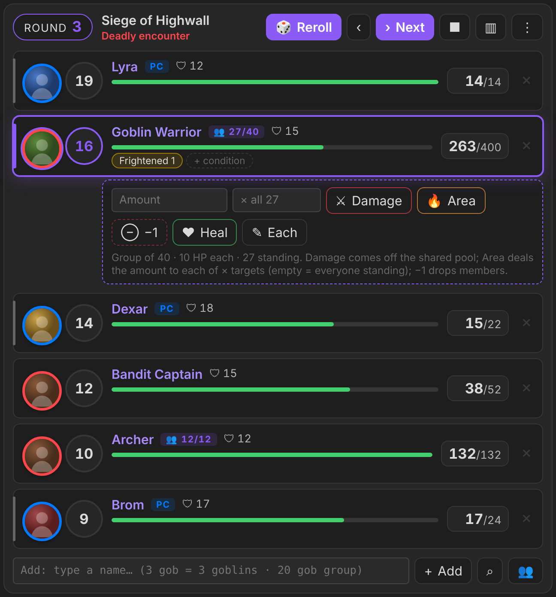

| 50 goblins in groups of 10 | Casualties after an area attack |
|---|---|
| 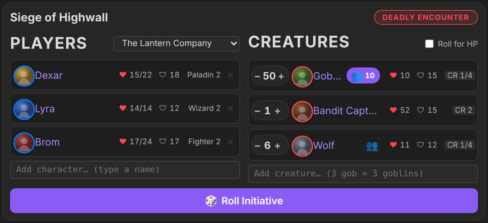 | 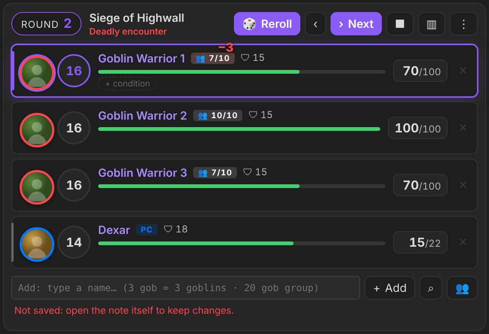 |

### Concentration at a glance

- **Badge:** anyone with the **Concentrating** condition gets a purple **Concentrating** badge on their row. Click it to end concentration.
- **Strip:** the top of the tracker lists everyone who's concentrating.
- **Save card:** when someone who's concentrating loses HP, a card shows the **Constitution save DC** (half the damage, at least 10, at most 30) and a **Roll CON save (+X)** button.
  - The roll goes through the dice hook, so it shows in the GM screen's dice tray.
  - The card then says whether they **keep** or **lose** concentration.
  - A lost save removes the condition, from the character sheet too.
- **Where the CON bonus comes from:**
  - characters: the character sheet's saving throws;
  - monsters: the statblock's `saves`, or its CON score.
- **At 0 HP** concentration ends by itself.
- **Player screen:** players see their own characters' badge and strip. A monster's concentration stays hidden, because concentrating is silent and only the spell's effect is visible. Turn on *Show monsters' concentration on the player screen* to reveal it.
- Turn it off under **Settings → Combat → Concentration at a glance**.

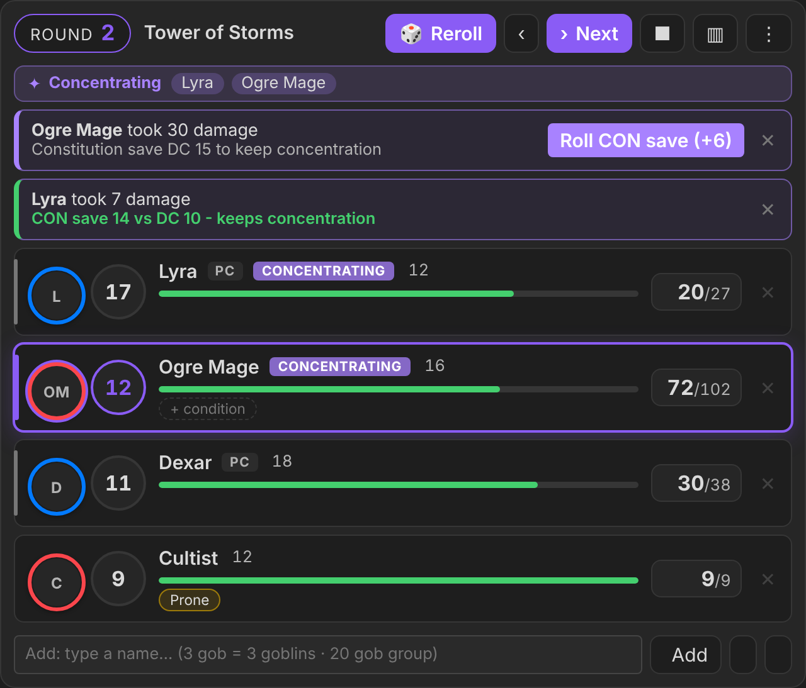

### Several initiatives at once

For when the party splits up, like a city attack where each group fights its own enemies somewhere else.

- **Start another one:** while an initiative is running, encounter cards show a **Run alongside** button next to **Roll Initiative**. (Roll Initiative itself asks too: *Run alongside* or *Overwrite*.)
  - The new fight goes into its own note: `Roll Initiative 2.md`, `Roll Initiative 3.md`, and so on.
  - **Overwrite** still replaces the fight shown in the sidebar.
- **Switch between them:** the top of the sidebar shows **‹ fight name ›** arrows and one dot per initiative.
  - The highlighted dot is the initiative whose turn it is.
  - **Turn: …** jumps straight to that initiative.
- **One shared turn order:** all the initiatives run together like one big initiative order, and turns are never skipped.
  - Example: a player with 20 in the first fight and a monster with 19 in the second. When the player presses **Next**, the turn goes to the monster, and the sidebar switches to the second fight by itself.
  - **Next** and **Previous** work from any of the initiatives.
  - The round is shared, too.
  - Condition durations still tick at the end of each creature's own turn.
- **A waiting initiative** says so at the top (*Waiting: the turn is in …*). Its dashed `>` marker shows who acts next there.
- **Joining mid-round:** a new initiative joins the current round. Its creatures act this round if their initiative is still to come, and the rest wait for the next round.
- **Stop and go back to setup** (↺ next to ■, or ⋮ menu): the initiative goes back to how it was before rolling. Round, turn and initiative values are cleared; HP and conditions stay. Press **Roll initiative** to start it again; a stopped initiative that ran alongside others rejoins their turn order.
- **Ending:** end one initiative (■, or all its enemies go down) and the others carry on. If it had the turn, the turn passes to whoever is next. When only one is left, it's a normal fight again.
- **Player screen:** shows the initiative whose turn it is.
- **Who takes the damage?:** offers the targets from the fight of whoever rolled.

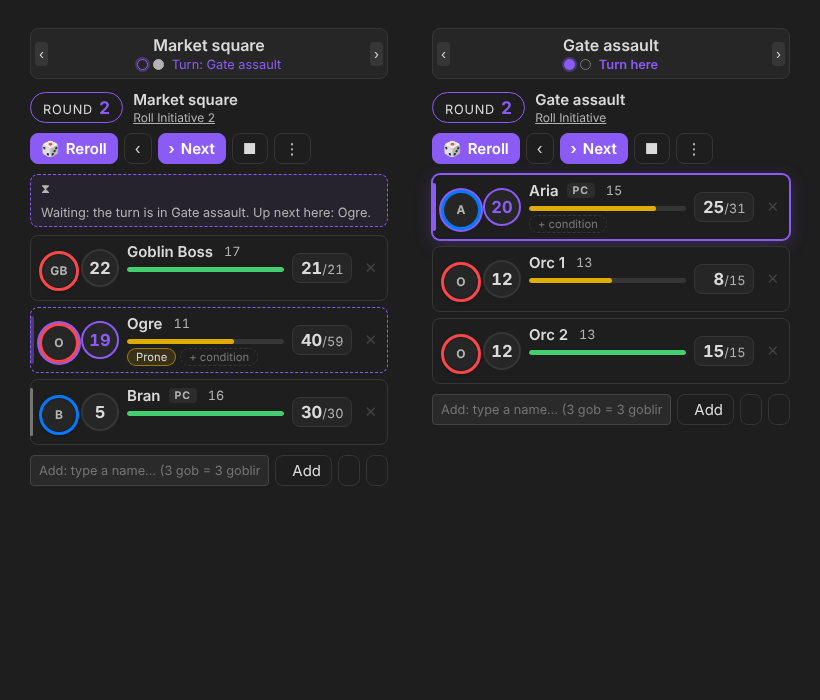

### Rolled damage and healing: "Who takes the damage?"

During a fight, when someone rolls **damage** or **healing**, a window asks **Who takes the damage?** (or **Who takes the heal?**). It catches rolls from:
- the dice tray of the **Game Master Interactive Screen**;
- the roll buttons on **One DnD Character Sheet**;
- **Fantasy Statblocks** actions (through the Dice Roller plugin).

To use it:
- **Click a creature** and the HP is taken off, or added, straight away. This works for character sheets, groups and Cyberpunk armour too.
- **Several targets…** lets you tick everyone caught in a Fireball and apply to all of them.
- **½** halves the damage for a successful save or resistance. You can also type any amount.
- **Nobody** closes the window.

The likely targets come first:
- for damage, the other side, with the attacker and anyone who's down at the bottom;
- for healing, the healer's own side.

Attack rolls, checks and initiative rolls are ignored. Turn it off under **Settings → Rolled damage and healing**.

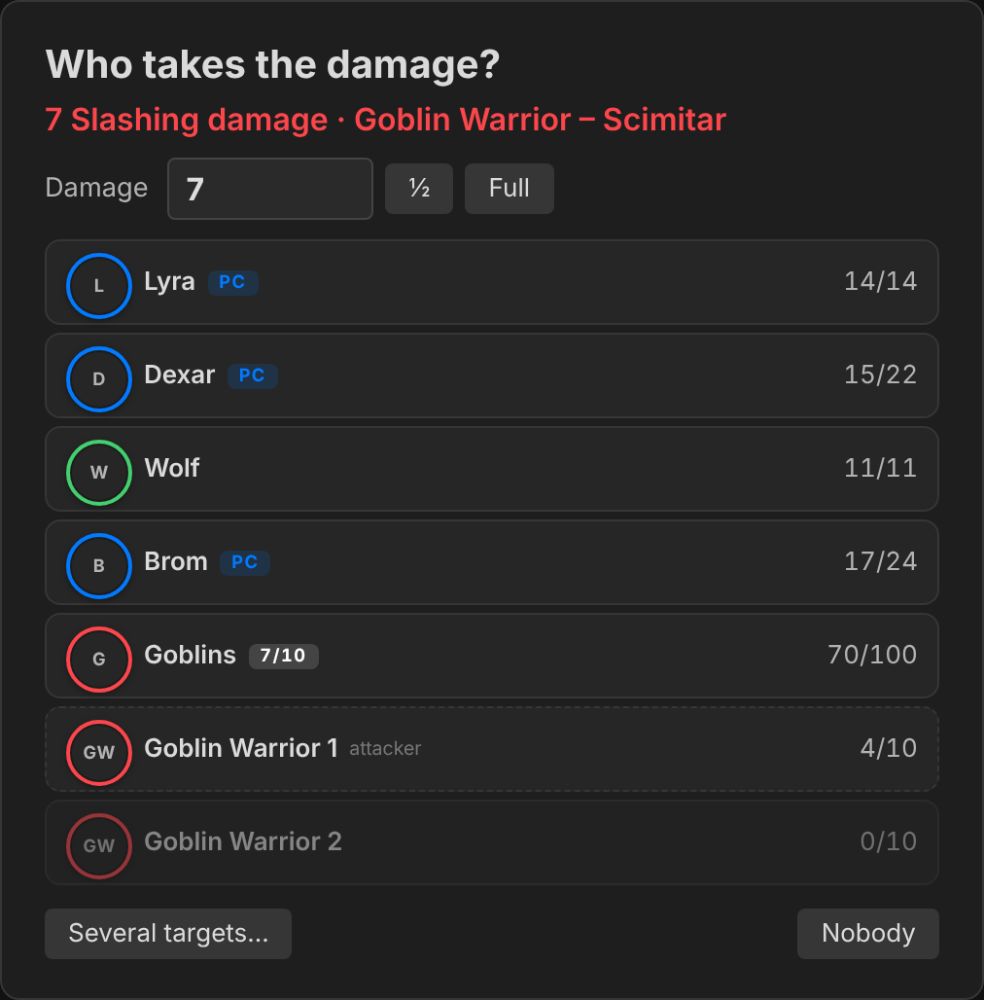

### Player screen

Show the fight to your players on a second screen with **[TTRPG Tools – Player Screen](https://github.com/jareika/ttrpg-tools-screen)** by Jareika.

- Click the **monitor** button in the tracker's header (or ⋮ → *Show on player screen*, or run the command *Show initiative on player screen*).
- The players see the round, the order, whose turn it is, tokens, names, PC / ally / neutral tags, group counts with casualties, health bars, conditions and death saves.
- They never see HP numbers, AC / SP, any buttons, or creatures you've marked **hidden**. Revealing a creature puts it on their screen.
- The view is live: every change you make in the tracker shows up there immediately.
- **Settings → Player screen → Health bars** controls the bars: everyone, player characters only, or nobody.

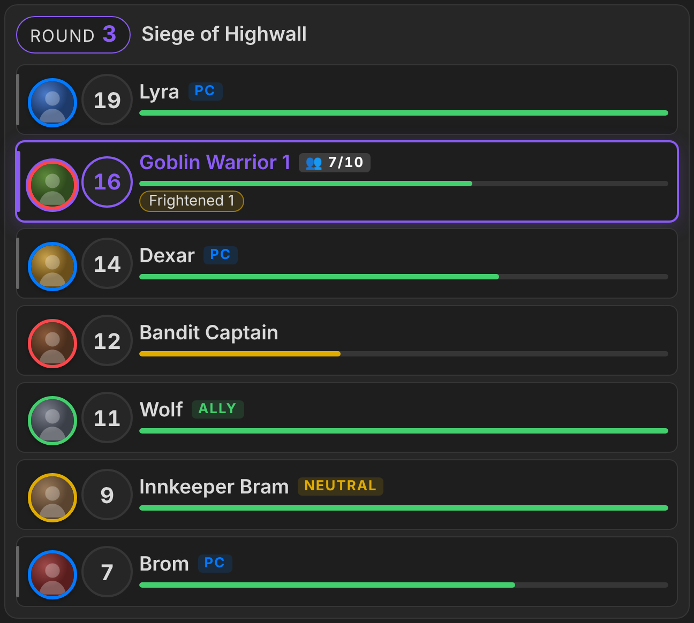

### Cyberpunk RED mode

Settings → Roll for Initiative → **Game system** → *Cyberpunk RED*. In this mode:

- **Initiative** is 1d10 + REF. Bonuses such as a Solo's *Combat Awareness* are added automatically.
- **Armour**: each location has its own SP. A hit is marked **Body**, **Head** or **Direct**:
  - damage over the SP gets through, and that SP drops by 1;
  - head hits double the damage that gets through;
  - Direct ignores armour.
- **Wounds**: *Seriously Wounded* and *Mortally Wounded* are applied automatically.
- **Death Saves**: a Mortally Wounded creature gets a **Death Save** button.
- **Critical Injuries** deal their 5 bonus damage when you add them as a condition.
- **Player notes**: everything is read from and written to the note's properties. It works with the *Cyberpunk RED Character Sheet* plugin.

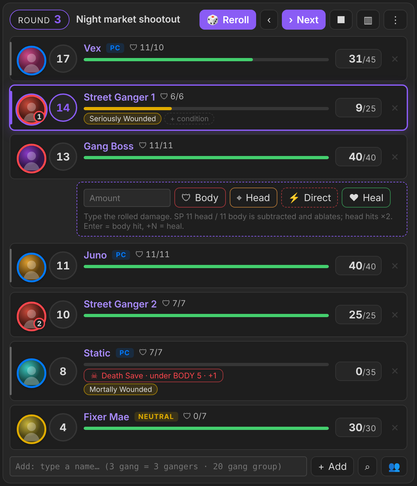

---

## Installation

Roll for Initiative is **not in the Community plugins list yet**, so you can't install it from **Browse** in Obsidian. Use one of these two ways.

### Option A: BRAT (recommended; installs and updates inside Obsidian)

1. In Obsidian, open **Settings → Community plugins** and turn off **Restricted mode** if it is on.
2. Click **Browse**, search for **BRAT** (*Obsidian42 - BRAT*), then **Install** and **Enable** it.
3. Open **Settings → BRAT → Add Beta plugin**.
4. Paste this repository's address: `https://github.com/YOUR-GITHUB-USERNAME/roll-initiative`
5. Click **Add Plugin**. BRAT downloads the latest release.
6. Go to **Settings → Community plugins** and switch on **Roll for Initiative**.

BRAT checks for new releases when Obsidian starts. You can also run **BRAT: Check for updates** from the command palette.

### Option B: by hand

1. Download `main.js`, `manifest.json` and `styles.css` from the [latest release](../../releases/latest).
2. In your vault, create the folder `.obsidian/plugins/roll-initiative/`. The `.obsidian` folder is hidden: turn on hidden files in your file manager.
3. Put the three files in that folder.
4. Restart Obsidian, or run **Reload app without saving**, then go to **Settings → Community plugins** and switch on **Roll for Initiative**.

To update, replace the three files with the ones from the new release.

### Recommended companion plugins

| Plugin | Why |
|---|---|
| [Fantasy Statblocks](https://github.com/valentine195/obsidian-5e-statblocks) | Monster statblocks: the stat source and the statblock pane |
| One DnD Character Sheet | Live D&D 2024 player sheets (HP, conditions, death saves) |
| Cyberpunk RED Character Sheet | Live Cyberpunk RED player sheets |
| Atlas VTT | Battle maps; encounters and live token sync |

None of them is required. Without them, type HP and AC into the block yourself.

---

## Quick start

### The fastest way: the ⚔ icon in the left ribbon

Click the **swords icon** in Obsidian's left ribbon. A window asks what you want to prepare:

- **Combat encounter** creates a full encounter note in your **Encounters folder** (Settings). It holds the whole initiative order, with every player and creature on its own row, ready to roll and run.
- **Initiative tracker** builds a compact prepared encounter with a **Roll Initiative** button and gives you its text with a **Copy and Close** button. Paste it into your adventure or session notes and press the button when the fight starts.

The next step works the same for both:
1. Name the fight.
2. Pick the players (a party, chosen characters, or none).
3. Type creatures (`3 gob` = 3 goblins).
4. For armies, choose *One by one*, *One group* or *Groups of 10*.

| Choose | Set up |
|---|---|
| 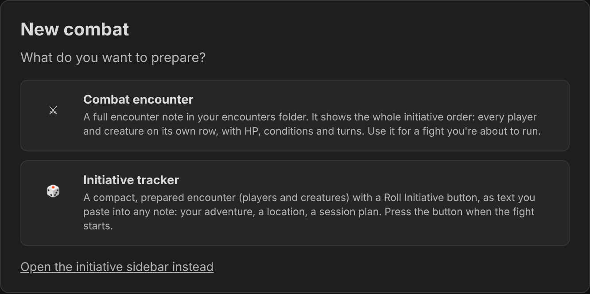 | 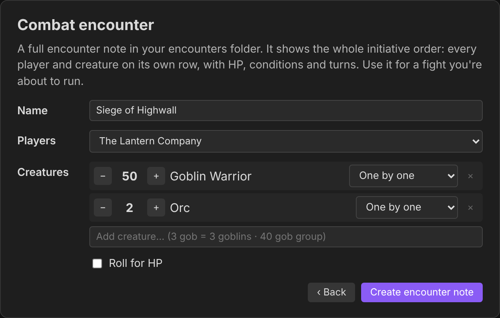 |

### By hand

1. Open the command palette (Ctrl/Cmd + P) and run **Roll for Initiative: Insert combat block**. Or create an encounter card with an empty block:

   ````
   ```roll-encounter
   ```
   ````

   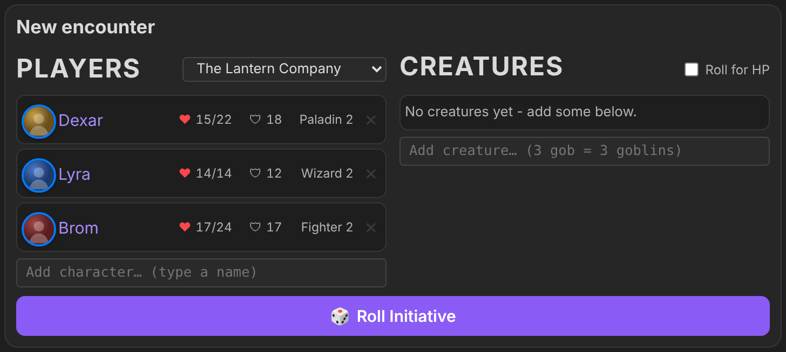

2. Pick your party, type monsters into the **Add creature** box (`3 gob` = 3 Goblins), then press **Roll Initiative**.
3. Use **Next** / **‹** to move through turns.
   - Click a creature's HP to deal damage or heal it.
   - Hover over a row to add conditions.
   - Press **■** to end the fight.

### The block format

The format comes from Quick Initiative. A filled block looks like this:

````
```roll-encounter
name: Ambush at the old mill
party: The Lantern Company
creatures:
  - 3: [[Goblin Warrior]]
  - 1: [[Bandit Captain]]
  - 1: [[Wolf]], ally
```
````

During a fight, the tracker keeps the combat as readable text:

````
```roll-initiative
name Ambush at the old mill
round 2
> Goblin Warrior 1 [[Goblin Warrior]] init 16 hp 4/10 ac 15 (Prone, Frightened:2)
[[Dexar]] player init 14
[[Wolf]] init 11 hp 11/11 ac 12 ally
```
````

The **[full guide](docs/GUIDE.md)** covers everything else:
- every token of the block syntax;
- all the controls;
- the settings;
- Atlas VTT sync;
- the Cyberpunk RED rules;
- the events other plugins can listen to.

---

## Settings

| Setting | What it does |
|---|---|
| Game system | D&D 5e (2024) or Cyberpunk RED |
| Roll Initiative note | The note every fight is written to (default `Roll Initiative.md`) |
| Encounters folder | Where the **New encounter note** command creates encounter notes |
| Group size / Group automatically from | Default group size for armies, and from which count creatures start as a group |
| Show casualties | Floating −N over a group's HP bar when members go down |
| Health bars on the player screen | Everyone / player characters only / nobody |
| Ask who takes rolled damage / healing | The "Who takes the damage?" window for damage and healing rolls during a fight |
| Ask players for initiative | Opens a window to type each player's own roll |
| End combat when all enemies are down | Auto-end (on by default) |
| Monster / NPC / Players folders | Where to look for creatures, neutral NPCs and (Cyberpunk) player notes |
| Atlas VTT live sync | Mirrors the fight onto an open Atlas map |

---

## API for other plugins

Other plugins (for example a GM screen) and scripts can drive Roll for Initiative through `api`:

```js
const ri = app.plugins.plugins["roll-initiative"]?.api;
if (!ri) return; // not installed or not enabled
```

Everything below also works from the developer console (Ctrl/Cmd + Shift + I).

### `ri.version`
The plugin version as a string, so you can check which calls exist.
```js
if (ri.version >= "1.5.0") { /* getState, setRoller, … are available */ }
```

### `ri.getState(sourcePath?, id?)` → `Promise<state | null>`
The state of the active fight, or of the block `id` in the note at `sourcePath`. Returns `null` when there's no encounter.
```js
const st = await ri.getState();
// {
//   sourcePath, id, name, round,
//   running, ended,
//   waiting,          // true: runs alongside others and the turn is in another one
//   initiatives: 2,   // how many initiatives run together (1 = just this one)
//   current: "Goblin 1", next: "Dexar",
//   combatants: [{ name, link, init, hp, maxHp, temp, ac, player, live, conditions: ["Prone"],
//                  disp: "enemy" | "ally" | "neutral", hidden, off, current,
//                  group: { size: 20, alive: 14, each: 10 } | null }]
// }
```
- `link` is the creature's note path when it has a note.
- Player characters report `disp: "ally"` and `player: true`.

### `ri.newCombat(options?)` → `Promise<result | null>`
Opens the **New combat** window and resolves when the user finishes it, or with `null` if they close it without creating anything.
```js
const res = await ri.newCombat({ kind: "encounter", players: ["Party/Dexar.md", "Party/Lyra.md"] });
// { kind: "encounter", path: "Encounters/Gate.md", id: "k3j9xq", name: "Gate" }
const card = await ri.newCombat({ kind: "initiative" });
// { kind: "initiative", text: "```roll-encounter\n…```\n", name: "…" }  (no copy window)
```
- `kind`: `"encounter"` or `"initiative"` skips the first step.
- `players`: note paths (or link text) to pre-fill the party.

### `ri.addCombatant(line, target?)` → `Promise<boolean>`
Adds creatures to the active fight, or to `target = { sourcePath, id }`, using the block line syntax.
```js
await ri.addCombatant("3x [[Imp]]");
await ri.addCombatant("20 [[Orc]] group");
await ri.addCombatant("[[Dexar]] player", { sourcePath: "Encounters/Gate.md", id: "k3j9xq" });
```
- Stats come from statblocks.
- In a running fight, the newcomers' initiative is rolled (one batch through the dice hook) and they're sorted into the order.
- Returns `false` when there's no encounter.

### `ri.setRoller(roller | null)`: dice hook
Lets another plugin make the tracker's dice rolls, for example to show them in its own dice tray. `roller.rollMany(requests)` gets an array of requests and must resolve to an array of totals in the same order.
```js
ri.setRoller({
  rollMany: async (requests) => {
    // [{ formula: "1d20+3", label: "Goblin 1", kind: "initiative" | "hp", sourcePath, id }, …]
    return requests.map(() => 10); // the final totals, modifier included
  },
});
ri.setRoller(null); // back to the built-in dice
```
- **What goes through it:**
  - initiative: Roll initiative, the single "Roll +X" button, the dice button in the player-initiative window, and creatures joining a running fight;
  - rolled HP: the *Roll monster HP* setting and the encounter card's *Roll for HP*.
- **Batches:** rolling for everyone sends one `rollMany` call with every request. With *Group initiative* on, there's one request per creature type.
- **Fallback:** if `rollMany` throws, returns the wrong number of values, returns non-numbers, or takes longer than 15 s, the built-in dice roll instead. Combat never gets stuck.

### `ri.applyRoll(roll)` → `Promise<boolean>`
Opens **Who takes the damage / heal?** for a roll, even when the setting is off.
```js
await ri.applyRoll({ total: 12, kind: "damage", damageType: "Fire", who: "Aria", action: "Fireball" });
await ri.applyRoll({ total: 7, kind: "healing", who: "Dexar", action: "Cure Wounds" });
```
- `kind` is `"damage"` or `"healing"`; other kinds are ignored.
- `who`, `whoPath`, `action` and `damageType` are optional. `who` / `whoPath` decide who's listed first.
- Roll for Initiative also listens to the GM screen's `game-master-screen:rolled` event (`{ total, kind, damageType, who, whoPath, action, crit }`), so the GM screen doesn't need to call this for its own rolls.

### Small calls
```js
await ri.rollInitiative();                         // same as pressing Roll initiative (active fight)
await ri.rollInitiative({ sourcePath, id });       // …or a given fight
await ri.endCombat();                              // same as the End combat command
await ri.showOnPlayerScreen();                     // same as Show initiative on player screen
ri.getActive();                                    // { path, id } of the sidebar fight, or null
ri.next(); ri.previous();                          // next / previous turn
```

### Events
```js
plugin.registerEvent(app.workspace.on("roll-initiative:change", (state) => { /* same shape as getState() */ }));
plugin.registerEvent(app.workspace.on("roll-initiative:created", (result) => { /* same shape as newCombat() */ }));
```
- `roll-initiative:change` fires:
  - on every change;
  - when a fight ends (`ended: true`);
  - when the active fight switches. When no fight is active any more, it fires with `{ cleared: true, combatants: [], … }`.
- `roll-initiative:created` fires whenever the New combat window creates something, whether it was opened through the API or by hand.

## Credits

Roll for Initiative stands on the shoulders of these projects. Thank you to their authors.

- **[Quick Initiative](https://github.com/walkertbrown/quick-initiative)** by **walkertbrown** (Bananafest Destiny), MIT License. **This is the base plugin.** Roll for Initiative takes from it:
  - the idea of keeping the whole fight as plain text in a note;
  - the ` ```…``` ` block format and its tokens (`init`, `hp`, `ac`, `>`, `2x`, `(conditions)`);
  - the look and layout of the tracker.

  This is a separate plugin with its own code, built to add live character sheets, encounter cards, game systems and VTT sync. If you only need a light, fast tracker, use Quick Initiative.
- **[Initiative Tracker](https://github.com/valentine195/obsidian-initiative-tracker)** by **Jeremy Valentine** (javalent) gave us:
  - the `encounter` block syntax used by ` ```roll-encounter ``` `;
  - the sidebar creature view;
  - the idea of writing HP back to player notes.
- **[Initiative Tracker Plus](https://github.com/msweat254)** by **Mike** (msweat254), a community fork of Initiative Tracker, inspired the encounter card's behaviour.
- **[Fantasy Statblocks](https://github.com/valentine195/obsidian-5e-statblocks)** by **Jeremy Valentine** renders the statblock pane and supplies the bestiary.
- **Atlas VTT** by **[Fabian Urbanek](https://github.com/ByteMirror)** is the battle-map plugin the live sync talks to. **[Connect for Atlas VTT](https://github.com/evolJoaoBento)** by *Bento's Grimoire of Things* showed how to reach an open Atlas map.
- **One DnD Character Sheet** and **Cyberpunk RED Character Sheet** are companion plugins by the same author as this one.

The full list, with licences, is in [CREDITS.md](CREDITS.md).

## Disclaimer

This is an unofficial fan project.
- *Dungeons & Dragons* is a trademark of Wizards of the Coast.
- *Cyberpunk RED* is a trademark of R. Talsorian Games.
- No game text or art ships with this plugin. The screenshots use made-up characters and generated tokens.

## License

[MIT](LICENSE) © 2026 Majsnic
